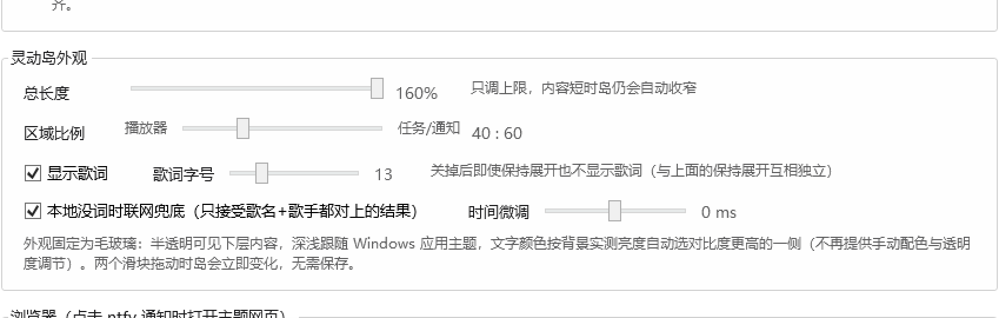
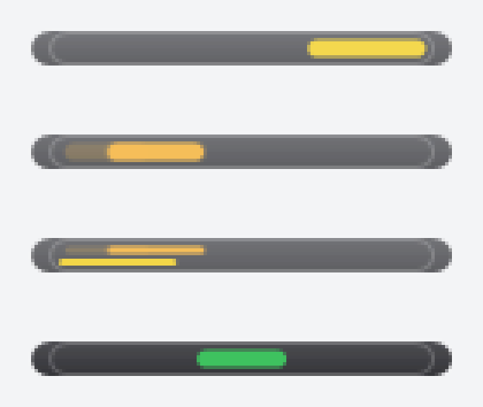

# NotifyHub

Windows 桌面「消息聚合通知 + 灵动岛 + 音乐控制」工具。
把**微信 / QQ / ntfy** 三个来源的消息统一成 macOS 风格通知横幅，同时提供一个
**WorkBuddy 任务状态灵动岛**（内含音乐播放器快捷控制）。托盘常驻、免安装、
自包含单文件 exe、弹窗不抢键盘焦点。

**下载**：[Release v0.2.12](https://github.com/lingli00/NotifyHub/releases/tag/v0.2.12)
→ `NotifyHub-v0.2.12-portable-win-x64.zip`（解压即用）或 `NotifyHub-v0.2.12-source.zip`（完整工程）。

> 为什么要用 UI Automation 轮询？微信 / QQ 不向 Windows 系统通知中心写入消息，
> 所以只能直接读它们的会话窗口（UIA），做快照差分来发现新消息。

---

## 界面预览

| 通知横幅（四段式，支持滑动取消） | 灵动岛：音乐 + 双行歌词（无任务时） |
| --- | --- |
|  |  |

| 灵动岛：两栏配平（歌词左 / 任务右） | 只有任务时（整条自适应） |
| --- | --- |
|  |  |

| 设置面板：灵动岛收纳 + 歌词 | 设置面板：订阅 / 浏览器 |
| --- | --- |
|  |  |

| 灵动岛外观：总长度 / 左右分配比例（拖动实时预览） |
| --- |
|  |

| 岛内通知：任务 + ntfy 并存（各取来源色） | 岛内通知：音乐 + QQ（只有一项在跑时进岛） |
| --- | --- |
|  |  |

| 收纳细条：仅音乐 / 仅任务 / 两者同跑 / 完成态 |
| --- |
|  |

| 运行日志（原独立控制台已并入） | AI 任务进度实时上岛 |
| --- | --- |
|  |  |

灵动岛在最后一次状态更新后按设定时长（默认 3 秒）自动收成顶部细条，鼠标移上去即展开：


---

## 一、它能做什么

| 能力 | 说明 |
| --- | --- |
| 微信消息通知 | UIA 轮询会话列表（默认 300ms），解析「联系人 + 摘要」，做差分去重后弹通知 |
| QQ 消息通知 | 无障碍树可读时逐条推送；不可读时降级为「QQ 收到一条新消息」（5 秒冷却） |
| ntfy 订阅 | 订阅 ntfy 主题（SSE），断线自动重连并带 `since=` 续传，不丢消息；**点击通知直接打开该 topic 的 Web UI**（浏览器可配） |
| 微信消息过滤 | **只推好友私聊 + 未开免打扰的群**；公众号、服务号、服务通知、广告营销、免打扰会话全部在接收阶段拦截 |
| macOS 风格通知 | 深色毛玻璃、圆角 20、四段式（图标+来源 / 会话名 / 预览 / 时间）、180ms 淡入淡出、四角可切换、新通知在最上 |
| 消息提示音 | 程序内置独立提示音（5 种音色可试听），仅放行消息播放；开关 + 音量独立控制；**开启时自动静音微信/QQ 自带提示音** |
| 灵动岛 | 两栏配平：左栏「音乐行 + 双行歌词」、右栏「WorkBuddy 标签 + 动作文字 / 通知行」，中间竖分隔线；展开 180ms / 文字切换 120ms / 完成停留 600ms / 收缩 220ms |
| 岛常驻 | 启动即亮出顶部窄条，**没有音乐/任务/通知也不会消失**；有内容自动展开、超时收回窄条；全屏时整岛+窄条一起隐藏 |
| 双模式 | **待机空闲**（没有播放器/WorkBuddy 进程、也没有任务/播放/通知）与**信息展示**（任一进程打开即进入，不等播放/任务）两套形态；进程在线时岛内显示「● 音乐 / 播放器已打开」「● WorkBuddy / 已打开」，有真实内容时自动让位 |
| 窄条交互 | 待机态：悬停整条放大 1.06×、按「区域比例」分左右两段换色（左音乐黄 / 右 WorkBuddy 琥珀）、**双击左段开播放器、双击右段开 WorkBuddy**；信息态：悬停 260ms 自动展开看内容，不换待机配色、不接管双击 |
| 岛内容居中 | 只有一项内容（通知/音乐/任务）时整体居中；音乐+任务同时存在时按「区域比例」左右布局 |
| 悬停效果 | 岛 / 通知卡悬停只做**轻微放大**（2.5% / 2%，回弹缓动），不叠加任何遮罩、不变色 |
| 岛内通知 | 微信 / QQ / ntfy 通知在岛上独占一行（来源色圆点 + 标签 + 跑马灯正文），与音乐、任务各自配色互不干扰；**整行可点，点击直接打开这条消息**；收起后细条指示器也跟着换来源色 |
| 通知展示策略 | 音乐 + 任务**同时在跑** → 通知走四角弹窗；只剩一项或都空 → 新通知直接在岛内展示，不再弹四角 |
| 分辨率自适应 | 以工作区 1920×1040 为基准算**界面缩放**（0.85~1.7×），卡片、岛、细条全部等比；1080p / 2.5K / 4K 下卡片恒占屏高约 10.8%，四角恒贴边 8px |
| 双行歌词 | 上一行加粗高亮 = 当前句，下一行暗色小字 = 下一句；**播放进度驱动，每 90ms 校正一次**，随进度自动切行、自动滚动，无需暂停再播 |
| 歌词来源 | **本地 `.lrc` 优先**（音乐库 / 播放器歌词缓存，按歌名+歌手匹配，UTF-8/GBK 自动识别），本地命中就绝不联网；本地没有才用严格匹配（0.9）的联网兜底；支持 `[offset:]` 偏移与 `作词/作曲` 等元信息行过滤 |
| 歌词进度校正 | SMTC 的 `Position` 是「最后一次上报时刻」的快照，所以按 `LastUpdatedTime` 算**上报年龄**补偿 + 播放中位置只增不减 → 逐句切换误差实测 **≤120ms**（要求 300ms 内） |
| 歌词开关与字号 | 设置里可整体关掉歌词（只留音乐行与任务文字），字号 10~22 可调，保存后立即生效；岛宽随之自适应，不会挤掉右侧任务区 |
| 歌词可靠性 | 取词失败只退避 25 秒（不进永久缓存）+ 幂等补取（最多 3 次 / 间隔 8 秒）+ **2 秒看门狗**巡检 → 不再出现"开了歌词却空白" |
| 自动收纳 | 单一计时器统一判定：**无论是否在跑 WorkBuddy 任务**，最后一次状态更新后按设定时长（默认 3 秒，1~60 可调）收成顶部细条；新消息 / 新任务 / 状态更新都会重新弹出并重置倒计时；可整开关，也可选「音乐播放时保持展开」 |
| 岛尺寸可调 | 设置里两组实时预览滑块：**总长度**（60~160%）、**左右分配比例**（25~75，左=播放器区）；拖动即时重排，不点保存不落盘 |
| 长文本跑马灯 | 歌名 / ntfy 正文 / 任务状态超宽时**自动横向无缝滚动**（悬停暂停、移开恢复），速度可调（10~120）；短文本水平居中，长文本滚动时可视区中心钉在岛中心 |
| 拖拽 | 自由模式下按住条体空白处拖动，**左键、右键都能拖**，按钮区域自动让位给点击 |
| 停靠规则 | 只允许停靠**屏幕顶部**：最左 1/5 与最右 1/5 禁停，仅中间 3/5 可拖可吸附；超时后吸附到顶部并收成横细条，鼠标移上去即展开 |
| 状态通道 | 命名管道长连接 + `--island-stream`：**连续更新延迟 <100ms**（实测每行 0.12ms） |
| WorkBuddy 任务监控 | **自动**读取 WorkBuddy 本地会话记录：AI 每一步动作实时上岛（运行/修改/检索/派出助手…），回合结束绿勾 + 完成提示音，无需任何手动接线 |
| 任务完成提示音 | 与消息提示音完全独立的第二套音效，完成态出现时播放 |
| 音乐控制 | 系统 SMTC 聚合各播放器（Folia、网易云、QQ音乐、Spotify 等），同一悬浮条内显示「App 图标 + 歌名-歌手 + 上一首/播放暂停/下一首」；**只有内置音乐名单内的进程才显示**（浏览器刷视频/直播一律忽略），无音频自动隐藏 |
| ntfy 多订阅 | 每个订阅地址独立开关、名称与强调色（5 色低饱和色板），通知卡按订阅分色，来源标签「ntfy · 家庭」；旧单地址配置自动迁移 |
| ntfy 下行推送 | 灵动岛里 WorkBuddy 任务过程的中文原文，原样推送到手机端（与岛内显示完全一致） |
| 消息游标 | 各来源已读进度落盘（`cursor.json`），重启不补弹旧消息；首运行只建基线 |
| 智能隐藏 | 无音频 → 音乐区隐藏；无任务 → 任务区隐藏；检测到全屏观影/游戏 → 整套灵动岛隐藏，退出后恢复 |
| 运行日志 | 设置页「运行日志」标签页：大号深色日志框（按级别着色、自动滚到底、可暂停）、最近 50 条事件。**独立控制台窗口已取消** |
| 导出 Bug 快照 | 设置页「诊断与反馈」一键导出：整屏截图 + 点击前后各 10 秒的五个核心模块日志（歌词/岛布局/通知渲染/设置UI/交互控制）+ 整套配置；查看页左图右日志对照。**只在手动点击时采集**，闲置零开销 |
| 一键清除日志 | 设置页按钮 + 二次确认，只清日志，不动配置与去重记录 |
| 便携绿色包 | 解压即用，不写系统注册表；配置文件跟随程序目录，换目录运行配置不丢 |

---

## 二、界面一览

* **通知横幅**：屏幕四角（默认右上）纵向堆叠，最多 5 条，新通知在最上方；鼠标移入暂停倒计时，点击激活微信/QQ 并定位到对应聊天。
* **灵动岛 / 音乐悬浮条**：一个深色毛玻璃长条，两栏布局
  `左：[App 图标] 歌名-歌手 [⏮][⏯][⏭] + 双行歌词` ｜ `右：[● 来源] 一行任务动作`。

  * 两栏按内容配平：有任务时左 262 / 右 262 起算，只有音乐时左侧独占整条；歌词左缩进与歌名左边界对齐（差 1px 内）。
  * 固定模式锁定顶部居中（不可拖动）。
  * 自由模式按住空白处拖动（左键、右键均可），位置自动保存；超时（默认 3 秒）自动吸附到**屏幕顶部**并收成横细条。
  * 停靠分区：最左 1/5 与最右 1/5 禁停，仅中间 3/5 可拖可吸附（以岛中心点判定）；任何情况下整条都会留在屏内。
  * 歌名 / ntfy 正文 / 任务状态 / 歌词超宽时自动横向滚动（悬停暂停），短文本按锚点对齐；滚动速度可调。
  * 条体现已按内容自适应，阴影留白足够，不再出现"比内容大一圈的灰白模糊方框"。
  * 阴影留白区做鼠标穿透（`WM_NCHITTEST` → `HTTRANSPARENT`），不会挡住下层窗口的点击。
* **设置 + 运行日志**：托盘双击或右键「设置 / 日志…」打开，两个标签页：
  * **设置**：ntfy 订阅（多地址 + 分色）、ntfy 下行推送、监听与显示、灵动岛（位置模式 / 音乐开关 / 自动收纳开关与超时 / 播放时保持展开 / 滚动速度）、灵动岛外观（总长度 / 左右分配比例 / 歌词开关与字号 / 联网兜底 / 时间微调）、浏览器四选一、两套提示音、微信过滤、诊断与反馈（导出 Bug 快照）。
  * **外观固定为毛玻璃**：不再提供主题 / 文字配色 / 透明度手调——底色跟随系统深浅，并按窗口背后亮度自动选对比度更高的文字色。
  * **运行日志**：等宽字体详细日志（DBG/INF/SUC/WRN/ERR 着色）+ 最近 50 条事件。

---

## 三、命令行参数

```
NotifyHub.exe                      托盘常驻运行
NotifyHub.exe --selftest           无界面逻辑自检（退出码 0=通过，75 项）
NotifyHub.exe --selftest-ui        通知层自检（堆叠/位置/不抢焦点）
NotifyHub.exe --demo               弹 6 条演示通知并生成抓图
NotifyHub.exe --dump               导出微信/QQ 的 UIA 树（适配新版界面用）
NotifyHub.exe --locate 名字        激活微信并搜索定位到该聊天
NotifyHub.exe --sessions           读一次微信会话列表，打印解析结果（自己发的/未读/免打扰）
NotifyHub.exe --island "文本"      灵动岛：显示一行执行中动作
NotifyHub.exe --island-done "文本" 灵动岛：完成态 + 完成提示音后收起
NotifyHub.exe --island-stream      从标准输入逐行读状态（长连接，更新延迟 <100ms）
NotifyHub.exe --island-shot        离屏渲染四张岛截图（仅音乐 / 带译文 / 音乐+任务 / 仅任务）
NotifyHub.exe --strip-shot        离屏渲染四张收纳细条截图（仅音乐 / 仅任务 / 两者同时 / 完成态）
NotifyHub.exe --notice-shot        离屏渲染三张岛内通知截图（微信 / 音乐+QQ / 任务+ntfy）
NotifyHub.exe --snapshot           导出一条 Bug 快照（截图+前后各10秒核心日志）并打开查看页
NotifyHub.exe --fps-test           实测 5 秒渲染帧率与卡顿（核对高刷屏是否跑满）
NotifyHub.exe --env-report         打印系统版本 / DPI / 缩放 / 刷新率 / 能力探测（兼容性核对）
NotifyHub.exe --marquee-test       跑马灯离屏自检（5 项，出 PNG 并按非背景像素判定）
NotifyHub.exe --media toggle       控制播放器（play/pause/toggle/next/prev）
NotifyHub.exe --settings           只打开设置窗口并出三张截图（排版检查）
NotifyHub.exe --help               参数帮助
```

### 外部程序（如 WorkBuddy 后台任务）怎么集成

**方式一：单次命令（简单，但每次要付进程启动成本）**

```
NotifyHub.exe --island "正在梳理需求文档结构"
NotifyHub.exe --island "已解析 8 个章节，开始拆分任务"
NotifyHub.exe --island-done "任务完成"
```

单次命令的端到端延迟约 **270ms**，其中绝大部分是 exe 启动本身（约 250ms），
状态通道只占 1~2ms。

**方式二：常驻状态流（推荐，满足「更新延迟 <100ms」）**

进程只启动一次，之后每行状态走同一条管道长连接：

```powershell
# 交互式
$p = Start-Process -FilePath .\NotifyHub.exe -ArgumentList '--island-stream' -RedirectStandardInput stdin.txt

# 或直接管道（每一行就是一次状态更新）
@(
  'RUN|正在读取需求文档…'
  'RUN|任务 3/6：四边吸附与自动滑出'
  'DONE|两份包已就绪'
) | .\NotifyHub.exe --island-stream
```

协议（一行一条）：

| 行格式 | 含义 |
| --- | --- |
| `RUN|文本` | 执行中，黄点 + 文本；直接写纯文本等价于 `RUN|纯文本` |
| `DONE|文本` | 完成态，绿勾 + 文本，600ms 后收起并响完成提示音 |
| `MEDIA|toggle` | 媒体控制（toggle/play/pause/next/prev） |

实测：常驻流模式下每行状态写入 **0.12ms**，端到端（含 UI 上屏）远低于 100ms。

---

## 四、配置（config.json）

便携模式下配置文件在 exe 同目录；否则在 `%AppData%\NotifyHub\config.json`。
保存后立即生效，坏文件会自动备份并回退默认值。

| 字段 | 默认 | 说明 |
| --- | --- | --- |
| `NtfyUrl` | `https://ntfy.sh/notifyhub-test` | 订阅地址（旧字段，保留用于迁移；新配置请用 `NtfySubscriptions`） |
| `NtfyEnabled` | `false` | 是否启用 ntfy |
| `WeChatEnabled` / `QQEnabled` | `true` | 监听开关 |
| `PollIntervalMs` | `300` | 轮询间隔，范围 300~2000ms |
| `NotificationDurationMs` | `4000` | 单条通知停留时长，范围 1000~30000ms |
| `NotificationCorner` | `TopRight` | `TopRight` / `TopLeft` / `BottomRight` / `BottomLeft` |
| `MaxStack` | `3` | 同屏堆叠上限（硬上限 5） |
| `IslandMode` | `Fixed` | `Fixed` 顶部居中锁定 / `Free` 自由拖动（含四边吸附） |
| `IslandLeft` / `IslandTop` | `null` | 自由模式保存的**拖拽落点**（DIP）；吸附位置不写盘，重启后从落点开始重新计时 |
| `MusicEnabled` | `true` | 音乐控制模块（勾选→显示、取消→隐藏，保存后立即生效） |
| `MarqueeSpeed` | `45` | 长文本跑马灯滚动速度（DIP/秒，范围 10~120） |
| `ThemeMode` | `GlassAuto` | `SolidDark` / `GlassDark` / `GlassLight` / `GlassAuto`（按桌面背景自动明暗） |
| `TextTone` | `Auto` | 文字配色：`Auto` 按背景深浅自动取高对比度色，也可固定 `Dark` / `Light` |
| `LyricsEnabled` | `true` | 歌词总开关；关掉后只显示音乐行与任务文字 |
| `LyricsFontSize` | `13` | 歌词字号，范围 10~22（保存即生效，岛宽随之自适应） |
| `AutoCollapseEnabled` | `true` | 自动收纳总开关（关掉则岛常驻展开） |
| `AutoCollapseSeconds` | `3` | 超时收纳时长，范围 1~60 秒；最后一次状态更新后重新计时 |
| `KeepOpenWhilePlaying` | `true` | 音乐播放期间保持展开（不按超时收纳） |
| `NtfySubscriptions` | `[]` | ntfy 多订阅：每项含 `Enabled`/`Name`/`Url`/`ColorIndex`；旧 `NtfyUrl` 自动迁移为第一条 |
| `NtfyPushUrl` | `""` | 下行推送地址（WorkBuddy 任务过程 → 手机）；留空 = 不推送 |
| `BrowserChoice` | `System` | `System` / `Chrome` / `Edge` / `Quark` / `Other`；前三项自动定位，`Other` 用 `BrowserPath` |
| `BrowserPath` | `""` | `Other` 时使用的浏览器程序或快捷方式（.exe / .lnk，可拖入） |
| `LogDir` | `""` | 日志目录；留空 = 程序目录下 logs；设置页「更改目录…」可改并迁移历史事件 |
| `MessageSoundEnabled` / `MessageSoundVolume` | `true` / `80` | 消息通知提示音开关与音量 |
| `MessageSoundStyle` | `DingDong` | 消息音色：DingDong/Crystal/Bubble/Marimba/Digital |
| `TaskSoundStyle` | `Ascend` | 完成音色：Ascend/Success/Bell/Chord |
| `SuppressAppSounds` | `true` | 消息提示音开启时自动静音微信/QQ 自带提示音 |
| `TaskSoundEnabled` / `TaskSoundVolume` | `true` / `80` | 任务完成提示音开关与音量 |
| `WeChatFilterEnabled` | `true` | 微信过滤总开关 |
| `WeChatBlockedKeywords` | 服务通知,公众号,… | 追加拦截关键词（逗号分隔，命中会话名或摘要即拦截） |
| `DedupHours` | `24` | 已推送消息 ID 缓存保留时长 |
| `AutoStart` | `false` | 开机自启（写 HKCU Run，便携模式默认关闭） |
| `DumpUiaOnStart` | `false` | 启动时导出 UIA 树（适配新版微信/QQ 用） |

---

## 五、工程结构与文件职责

```
NotifyHub/
├─ src/NotifyHub/
│  ├─ NotifyHub.csproj          项目文件：net8.0-windows10.0.19041（WinRT/SMTC）+ WPF，
│  │                            自包含单文件发布参数、版本号 v0.2
│  ├─ App.xaml / App.xaml.cs    应用入口：多模式分发（GUI/Demo/自检/Dump/Locate/Settings/
│  │                            Island/IslandStream/Media/Help）、灵动岛快路径、托盘、单实例互斥
│  ├─ Models/
│  │  ├─ AppConfig.cs           配置模型 + Normalize 收敛（含通知位置、两套音效、过滤关键词、
│  │  │                          ntfy 多订阅、浏览器四选一、日志目录）
│  │  ├─ NtfySubscription.cs    一条 ntfy 订阅（启用/名称/地址/色板索引）
│  │  ├─ NotifyMessage.cs       一条待通知消息（来源/发送者/内容/时间/去重键/来源标签/强调色）
│  │  └─ EventLogEntry.cs       事件列表条目
│  ├─ Services/
│  │  ├─ ConfigService.cs       配置读写（原子替换、坏文件备份、变更事件）
│  │  ├─ LogService.cs          日志文件 + 控制台环形缓冲 + 最近 50 条事件 + ClearAll + 目录热切换
│  │  ├─ AppPaths.cs            路径：便携模式（exe 旁 config.json）或 %AppData%
│  │  ├─ CommandLineOptions.cs  命令行解析
│  │  ├─ IslandIpc.cs           命名管道：长连接 + 多行读取 + --island-stream 流式转发
│  │  ├─ MonitorController.cs   监听总控：三来源 → 去重 → 通知
│  │  ├─ PollingWatcherBase.cs  轮询线程基类（扣耗时的间隔、异常不中断、日志节流）
│  │  ├─ ChatAppWatcher.cs      聊天软件公共流程：找窗口 → 读列表 → 差分 → 过滤 → 派发
│  │  ├─ WeChatWatcher.cs       微信监听（含免打扰/公众号/服务号过滤）
│  │  ├─ QQWatcher.cs           QQ 监听（可读则逐条，不可读降级）
│  │  ├─ NtfySubscriber.cs      ntfy SSE 订阅与重连（按订阅实例化，含 Basic Auth）
│  │  ├─ SessionDiffTracker.cs  会话快照差分（含中断恢复补发，防丢包）
│  │  ├─ MessageCursorStore.cs  消息游标持久化（重启不补弹旧消息，首运行只建基线）
│  │  ├─ DedupCache.cs          消息 ID 去重（落盘 24h，重启不重复）
│  │  ├─ WeChatFilter.cs        微信过滤规则（免打扰信号 + 公众号/服务通知关键词）
│  │  ├─ SoundService.cs        两套提示音（多音色合成 WAV，MediaPlayer 播放，音量独立，可试听）
│  │  ├─ AppSoundMuter.cs       Core Audio 会话级静音：消息音开启时静音微信/QQ 自带提示音
│  │  ├─ MediaPlayerMonitor.cs  SMTC 媒体会话聚合与播放控制（内置音乐名单，浏览器一律忽略）
│  │  ├─ PlaybackClock.cs       播放进度估算器：上报年龄补偿 + 播放中只增不减（歌词同步 ≤120ms 的地基）
│  │  ├─ ScreenMetrics.cs       屏幕度量：实时物理像素工作区 → DIP + 界面缩放 UiScale（分辨率自适应地基）
│  │  ├─ SystemCapabilities.cs  系统能力探测（版本/DPI/刷新率/合成/透明与动画开关），全部失败可回落
│  │  ├─ BugSnapshotService.cs  Bug 快照：截图 + 前后各 10 秒五模块日志 + 配置 + 元信息（仅手动触发）
│  │  ├─ ScreenCapture.cs       整屏截图（GDI BitBlt + CAPTUREBLT，能拍分层窗）
│  │  ├─ AppLauncher.cs         按进程名激活/启动应用（进程在跑绝不重复启动；启动走隐藏无窗）
│  │  ├─ PresenceWatcher.cs     进程在线巡检（播放器/WorkBuddy 一打开就切信息展示模式）
│  │  ├─ LocalLyricsLibrary.cs  本地歌词库（音乐库/播放器缓存里的 .lrc，UTF-8/GBK 自动识别）
│  │  ├─ LyricsService.cs       LRC 在线获取与解析（按歌名+歌手打分匹配，防串词）
│  │  ├─ AppIconExtractor.cs    从进程提取 App 图标（音乐栏左侧透明圆角图标）
│  │  ├─ BrowserLauncher.cs     ntfy 点击 → 浏览器打开 topic Web UI（四选一定位 + .lnk 解析）
│  │  ├─ NtfyPublisher.cs       ntfy 下行推送（灵动岛任务过程原文 → 手机，3 秒去重）
│  │  ├─ FullscreenWatcher.cs   全屏检测（前台窗口铺满显示器且无标题栏）
│  │  ├─ StartupService.cs      开机自启注册表
│  │  ├─ WindowActivator.cs     点击通知 → 激活微信/QQ 并定位聊天
│  │  ├─ ConsoleBridge.cs       无控制台进程的 stdout 输出
│  │  ├─ SelfTest.cs            自检用例（解析/差分/去重/配置/过滤/歌词进度与误差/收纳/四角几何/缩放/配色/能力探测等 62 项）
│  │  ├─ Parsing/
│  │  │  ├─ MessageTextParser.cs  UIA 文本 → (联系人, 摘要)，剥离置顶/未读前缀/噪声
│  │  │  └─ NtfySseParser.cs      SSE 帧与 ntfy JSON 解析
│  │  └─ Uia/
│  │     ├─ WindowFinder.cs       EnumWindows 纯 Win32 定位主窗口（避开 UIA 根枚举卡顿）
│  │     ├─ SessionListReader.cs  读会话列表 + 免打扰/公众号信号采集
│  │     └─ UiaDumper.cs          UIA 树诊断导出
│  ├─ UI/
│  │  ├─ NotificationWindow.xaml(.cs)     单条通知卡片（圆角 20、阴影留白 14px、180ms 动画）
│  │  ├─ NotificationManager.cs           队列 + 堆叠 + 四角定位
│  │  ├─ MarqueeText.cs                   长文本跑马灯控件（无缝循环、悬停暂停、速度可调、居中/左对齐锚点）
│  │  ├─ IslandWindow.xaml(.cs)           灵动岛：两栏配平布局（歌词/任务）、双行歌词、统一收纳计时器、Win32 拖拽、细条形态
│  │  ├─ SnapStripWindow.cs               收纳细条（贴顶横条；悬停/点击展开，指针已压在上面时不自动展开）
│  │  ├─ StripIndicator.cs                细条里的跑道指示器（音乐/任务/通知/完成四态自绘动画）
│  │  ├─ SourceColors.cs                  通知来源配色（微信/QQ/ntfy/音乐/任务/完成），卡·岛·细条三处复用
│  │  ├─ FrameClock.cs                    帧时钟去重 + 帧率实测（FPS 统计）
│  │  ├─ NotificationLayout.cs            四角通知几何纯函数（窗口/本体/步进/边距，含 scale）
│  │  ├─ ThemePalette.cs                  调色板（毛玻璃固定 + 背景亮度自动校正对比度）
│  │  ├─ IslandController.cs              灵动岛总控（音乐/全屏/提示音/位置/窗口预热）
│  │  ├─ SettingsWindow.xaml(.cs)         「设置 + 运行日志」双标签页（原控制台已并入）+ 诊断与反馈
│  ├─ SnapshotWindow.xaml(.cs)          Bug 快照查看页（左截图 / 右日志 / 模块过滤）
│  │  ├─ DemoCapture.cs                   窗口自渲染抓图（验证用）
│  │  └─ IconFactory.cs                   托盘图标绘制
│  ├─ Interop/NativeMethods.cs  Win32 互操作（窗口样式/SetCapture/SetWindowPos/激活/输入/版本与显示模式探测）
│  ├─ Interop/FolderPicker.cs   系统文件夹选择框（IFileDialog + FOS_PICKFOLDERS）
│  ├─ Assets/NotifyHub.ico      图标
│  └─ app.manifest              应用清单（DPI 感知）
├─ tools/
│  ├─ publish.ps1               一键发布单文件
│  ├─ pack.py                   打发布包（便携包 + 源码包）
│  ├─ grab.py                   区域抓屏（BitBlt + CAPTUREBLT，能抓透明窗口）
│  ├─ island_probe.py           灵动岛真机探测：读位置 / 真实鼠标拖拽（左键、右键）
│  ├─ stream_latency.py         量 --island-stream 每行更新耗时
│  ├─ push_api.py               走 GitHub Git Data API 推送提交（git 协议被墙时用）
│  ├─ release_api.py            走 API 创建 Release 并上传两个 zip
│  └─ …                         微信窗口诊断脚本
├─ docs/                        文档截图
├─ dist/                        发布产物（NotifyHub.exe）
└─ README.md                    本文档
```

运行期数据（便携模式在程序目录，否则 `%AppData%\NotifyHub`）：

```
config.json     配置
logs/           按天日志
events.json     最近 50 条事件
dedup.json      已推送消息 ID（去重，24h）
sounds/         自动生成的两个提示音 WAV
dump/           UIA 诊断树
```

---

## 六、构建 / 发布

需要 .NET 8 SDK（Windows）。仓库自带发布参数，直接：

```powershell
dotnet publish src/NotifyHub/NotifyHub.csproj -c Release -o dist
```

产物是自包含单文件 `dist\NotifyHub.exe`（约 73MB，含 .NET 运行时与 WPF/WinRT，免安装）。

自检与验证：

```powershell
.\dist\NotifyHub.exe --selftest        # 52 项逻辑自检
.\dist\NotifyHub.exe --selftest-ui     # 通知层自检（0=通过）
.\dist\NotifyHub.exe --demo            # 弹 6 条演示通知并抓图
python tools\island_probe.py info      # 读灵动岛位置/样式
python tools\island_probe.py drag 160 130   # 真实鼠标拖拽验证
python tools\stream_latency.py         # 状态流延迟
```

---

## 七、已知限制

* 微信 / QQ 的界面结构随版本变化，若某天读不到会话，请用 `--dump` 导出 UIA 树后按新结构调整
  `WindowFinder` / `SessionListReader` 的类名与结构匹配。
* 公众号/服务通知的识别依赖会话名/摘要关键词与 UIA 信号；若发现漏网的公众号，
  把它的名字加进 `WeChatBlockedKeywords` 即可。免打扰识别依赖会话项里的「消息免打扰」图标信号。
* 音乐控制依赖播放器是否向 Windows 上报 SMTC（Folia、网易云、QQ音乐、Spotify 等主流播放器均支持）。
* WPF 不支持 IL 裁剪，单文件体积主要由 .NET 运行时 + WPF + WinRT 组成，已开启单文件压缩。
* 便携版不写注册表；「开机自启」是可选功能，默认关闭。
* 单次 `--island` 命令仍有约 270ms 启动开销（.NET 运行时 + WPF 初始化），
  这是"一次进程启动"的固有成本；需要 <100ms 时应改用 `--island-stream` 长连接。
* 吸附位置不写盘：自由模式的吸附是**临时视觉状态**，配置里只保存用户亲手拖到的落点，
  这样重启后不会"一开机就贴在边上"。

---

## 八、版本

**v0.2.12** — 歌词本地优先 + 时间轴修正 / WorkBuddy 标签配色 / 待机左右分裂布局 / 悬浮可靠展开 / 轮询流水日志过滤

* **歌词**：新增 `LocalLyricsLibrary`，在音乐库与播放器歌词缓存目录里按「歌名 + 歌手」找 `.lrc`（UTF-8/GBK 自动识别），**本地命中就绝不联网**；本地没有才走联网兜底，匹配阈值 0.6 → **0.9**。`ParseLrc` 现在解析 `[offset:±毫秒]` 并平移整篇时间轴（"只有部分歌偏"的根因），同时过滤作词/作曲/编曲等元信息行
* **WorkBuddy 标签**：淡黄 10px 小字 → 按主题自动校正对比度的主文字色 + 11px + SemiBold，品牌色交给琥珀圆点
* **待机态左右分裂**：播放器进程在跑就保留左栏（图标 + 留空的歌名/歌词区 + 三个播放键可点），右栏只放 WorkBuddy/通知；左右 `MinHeight=46` 等高、标题字号统一，待机态也画竖分隔线
* **悬浮展开**：`IsMouseOver` 在分层窗上恒假（只放大不展开的根因）→ 改 `IsCursorInside()` 光标矩形判定，阈值 180ms；实测 122×10 → 418×31
* **日志**：新增 `LogService.Routine()`（默认不落盘），收纳计时/展开/进程巡检等流水全部改走它；相同 Debug/Info 行 2 秒内去重；通知推送、过滤、取词成败、WRN/ERR 全部保留

**v0.2.11** — 双击唤起黑窗/重复实例/幽灵图标修复 / 待机空闲·信息展示双模式 / 悬浮分区配色与双击收敛到待机

* **黑窗 + 幽灵任务栏图标 + 左上角空白方框**：上一版把"激活失败"当"没在跑"，又 `Process.Start` 拉了一个实例（第二个 WorkBuddy 实例建辅助窗口 → 任务栏点不开的按钮 + 左上角 16×16 空白窗）；同时 `UseShellExecute=true` 会给控制台程序弹黑窗。现在：**进程存在就绝不启动**（找不到窗口也只返回"在跑"）、必须启动时 `UseShellExecute=false + CreateNoWindow + Hidden` 并立即 `Dispose`、600ms 内重复双击直接吞掉
* **顺带修掉岛窗口重复创建**：`Island()` 先调回调再登记 `_island` → 回调里重入又建一个窗口（实测 5 个），改为创建即登记
* **待机空闲 / 信息展示双模式**：新增 `PresenceWatcher`（1.5s 轮询进程，只在变化时回调），播放器或 WorkBuddy 一打开就进信息模式并显示"进程在线"信息行
* **悬浮分区配色 + 双击唤起只在待机空闲模式生效**（需求 4）；信息模式悬停窄条 260ms 自动展开看内容
* 「设置」「Bug 快照」窗口不再占任务栏；快照前段日志为空时回退 60 秒

**v0.2.10** — 岛内容居中/比例布局 / 窄条交互重做（含"竖立白色椭圆"根治）/ 悬停改轻微放大 / 歌词非常驻模式同步 / 设置页文字裁切 / 导出 Bug 快照

* **单内容居中、双内容按比例**：新增 `IslandWindow.SplitFactors()` 纯函数——只有音乐+右侧内容同时存在才按「区域比例」分配，单内容两边系数都是 1.0；同时修掉"从窄条展开用旧 Left、`_hidden` 期间 SizeChanged 早退"造成的整体偏移（新增 `ScheduleRecenter()` 在布局后补一刀）
* **待机态白色竖椭圆根治**：它就是"空岛窗口"——没有内容时仍 `Show()` 了一个所有栏都 Collapsed 的岛，宽度塌到 40、圆角 22 就成了竖椭圆。现在没内容不展开，只保留窄条
* **窄条交互重做**：悬停放大 1.06×（不再"移入即展开"）、按区域比例分左右段、悬停换色（左音乐黄/右任务琥珀）、双击左段开音乐播放器、双击右段开 WorkBuddy（新增 `Services/AppLauncher.cs`）
* **悬停改轻微放大**：删掉通知行的黑色遮罩，岛放 2.5% / 卡片放 2%（回弹缓动）；顺带修掉"岛是点穿窗口 → `IsMouseOver` 恒 false → 悬停功能全部失效"，改为仅在可见时 120ms 读一次光标位置
* **歌词非常驻模式同步**：`IslandBecameVisible` 事件 + `MarqueeText.RestartScroll()` + `ResyncLyricsAfterShow()`（强制重定行号 + 重启滚动），两种模式共用同一段代码
* **设置页不再截字**：`HintText` 默认 `Wrap`、10 处横向 `StackPanel` 改 `WrapPanel`、截图前归零滚动
* **导出 Bug 快照**：整屏截图 + 前后各 10 秒五模块日志 + 整套配置，落盘 `snapshots\<时间>\`；查看页左图右日志对照、可切历史、可开目录；仅手动触发，闲置零开销

**v0.2.9** — 分辨率自适应 / 岛常驻 / 岛内通知（配色·跳转·展示策略）/ 歌词两个 Bug 根治 / 设置毛玻璃+双滑块 / Win10-Win11 兼容

* **全界面分辨率自适应**：`ScreenMetrics.UiScale` 以 1920×1040 工作区为基准算 0.85~1.7× 界面缩放，`NotificationLayout` 全参数化、卡片走 `LayoutTransform`、岛走 `Pill.LayoutTransform`、细条按比例；动画加 `FrameClock` 帧去重（一帧一次，高刷能跑满）
* **灵动岛常驻**：启动即亮窄条、无内容也不消失；`Evaluate()` 改成"没内容就留细条"，`CollapseToStrip()` 分三种入口；点/悬停手动展开（`_idleExpanded` 撑住），修掉"细条落在指针底下 → 每 10 秒自开合"的死循环
* **岛内通知**：`SourceColors` 统一色板（微信绿/QQ蓝/ntfy橙+多订阅色板）三处复用；通知行整行是按钮，点击直接打开这条消息；`NoticeGoesToIsland()` 决定"音乐+任务同跑→四角，其余→岛内"
* **歌词偶发不展示（4 个根因）**：网络失败被永久缓存 / 取词只试一次 / timeline 抛异常拖垮整条链路 / 开关从关到开不补取 → 全部修复 + 2 秒看门狗
* **歌词慢一秒**：`PlaybackClock` 重写——上报年龄补偿 + 播放中只增不减 + 去掉 0.35 比例收敛 + 轮询 90ms，实测逐句误差 119ms
* **设置界面毛玻璃**：删掉主题/文字配色/透明度，改自绘毛玻璃外壳（无边框 + 自绘标题栏 + 圆角 + 跟随系统深浅 + 背景亮度自动校正对比度）；新增总长度 / 左右分配比例两个实时预览滑块
* **Win10/Win11 兼容**：不使用任何 Win11 专属 UI 接口（不用 `DWMWA_SYSTEMBACKDROP_TYPE` / 圆角偏好），圆角/毛玻璃/动画全部自绘；`--env-report` 一条命令打印系统能力与降级策略

**v0.2.8** — 四角通知修复 / 播放器歌词区重做 / 岛 60 帧 / 细条跑道指示器 / 真居中与自适应宽度

* **修四角坐标**（核心 Bug）：`SystemParameters.WorkArea` 是**启动时按系统缩放缓存的 DIP 值**，运行期改缩放不刷新，导致右上/左下/右下三个角全错。新增 `ScreenMetrics`（实时 `MonitorFromPoint` + `GetMonitorInfo` + `GetDpiForSystem`）替代全部定位；新增 `NotificationLayout` 纯函数统一"窗口 384×140 / 本体 356×112 / 步进 120 / 边距 8"，四角一律实测边距 8
* **修堆叠方向**：`index 0` 恒为"最新且贴锚定边"——上角最新在最上向下堆、下角最新在最下向上堆
* **歌词独立开关 + 自带翻译**：关掉歌词后即使勾着「保持展开」也不显示；外文歌词按时间点合并 `tlyric` 译文，译文与原文相同则不占位
* **播放器 + 歌词区重做**：3px 贯穿脊线 + 统一缩进内容列，歌名与三行歌词共用一条左边界（运行时实测对齐），删掉旧固定行高与死空白
* **动画改帧驱动**：`DispatcherTimer(15ms)` → `CompositionTarget.Rendering`，动画里去掉 `DropShadowEffect`
* **细条跑道指示器**：12×124，仅音乐黄色来回 / 仅任务琥珀单向带拖尾 / 同时上下两条轨道 / 完成绿块居中，保留整条呼吸
* **岛真居中 + 自适应宽度**：三块宽度都按实测自然宽 `clamp`，仅音乐 304、长歌词 540、仅任务 261（左栏不占位）；固定模式左右留白实测差 1px
* 新增自检 4 项（四角几何 / 译文合并 / 自适应宽度与真居中 / 细条指示器），总计 52 项；新增 `--strip-shot`、`tools/corner_probe.py`、`tools/island_probe.py center`

**v0.2.7** — 灵动岛两栏配平 / 歌词实时同步 / 歌词字号与总开关 / 统一自动收纳

* **两栏配平布局**：左栏「音乐行 + 双行歌词」垂直堆叠，右栏「WorkBuddy 标签 + 动作文字」跨行居中，中间一条淡竖线分隔。有任务时左 262 / 右 262 起算，不再出现"左侧歌词挤成一团、右侧只剩一条缝"
* **修歌词卡死**（核心 Bug）：SMTC 的 `TimelineProperties.Position` 只是播放器最后一次上报的**陈旧快照**，正常播放期间不刷新，原来直接拿它定位歌词 → 整段卡住，只有暂停/播放触发上报才跳一下。新增 `PlaybackClock`：单调时钟在两次上报间外推进度，拖动/切歌大偏差直接采纳，小偏差温和收敛（0.35 系数），歌词计时器 250ms → 200ms
* **歌词开关与字号**：设置页新增「显示歌词」总开关与字号滑杆（10~22），保存即生效；关掉后岛自动收窄到只留音乐行
* **统一自动收纳**：原来 `_idleTimer`(10s) + `_returnTimer`(1.4s) 双计时器互相打架，导致"有时常驻、有时乱收"。改为单一 `_autoTimer`：任何状态更新都重置倒计时，到点收成顶部细条——**不再区分是否在跑 WorkBuddy 任务**；新消息走 `PokeMessage()`、新任务走 `ShowTask()`，都会先弹岛再重新计时
* **可配超时**：`AutoCollapseSeconds` 1~60（默认 3 秒）+ `AutoCollapseEnabled` 总开关 + `KeepOpenWhilePlaying`（播放期间保持展开）
* **三条收纳豁免**：鼠标停在岛上、完成态停留中、音乐播放且勾选了"保持展开"
* **整条留屏内**：岛加宽后可能伸出屏幕（自由模式保存的落点 + 更宽的岛），`ClampToScreen` / `MoveDrag` / `RecenterFixed` 统一加"整条必须完整可见"硬约束
* 新增自检 3 项（进度估算器 / 两栏配平 + 歌词字号 / 收纳默认值与区间收敛），总计 49 项

**v0.2.6** — 通知滑动取消 / 岛点按穿透 / 毛玻璃主题 / 动态文字对比度 / 双行歌词

* **通知滑动取消**：按住上滑或左右滑，过阈值松手带惯性飞出并关闭；不够则弹回原位，倒计时继续
* **岛点按穿透**：固定模式只有三个播放键可点，其余区域直接点透到下层 App
* **毛玻璃主题**：毛玻璃·深色/浅色/跟随系统 三档 + 纯色暗黑，通知与岛全局生效，设置页可切换带预览
* **动态文字对比度**：显示前对背景取样，按合成色自动选黑/白字（WCAG ≥ 4.5），另可强制白/黑
* **双行歌词**：L 形布局（左侧音乐+两行歌词，右侧任务进度），在线取 LRC 并随播放进度换行，取不到自动收起
* 修复：系统代理把 `127.0.0.1` 也劫持导致自建 ntfy 502（环回/私网直连）

**v0.2.5** — 订阅页排版修复 / 微信过滤重写（不再用名称关键词判类型）/ 夸克定位

* **订阅页排版**：勾选框被 18px 全局右边距裁掉、删除按钮被全局 `MinWidth=88` 撑成灰块且 `×` 被裁到面板外——两个都是全局样式与固定列宽冲突，已在控件上显式覆盖；新增列头（启用/名称/订阅地址/通知颜色/删除）
* **微信过滤重写**：不再对群名/好友名做关键词包含匹配（群叫“阿里云”曾被误判公众号）；改为真实信号判定——免打扰标记、微信内置系统会话规范名整名匹配、公众号文章链接、消息结构（私聊摘要就是裸内容+未读=他人消息；群聊带“成员: ”前缀；裸内容无未读=自己发的）
* **同文本新消息不再被吞**：差分比对未读数，对方再发一条同样的“1”也能识别
* **修复个人私聊被吞**：删掉“裸内容+未读=官方群发”这条错误规则（私聊摘要本来就是裸内容，导致 xiy624/xiy62 等个人消息全被拦）
* **全链路日志**：每条消息都有「收到 → 类型判定 → 放行/跳过（依据）」，不做节流
* **夸克定位修复**：真实路径是 `%LOCALAPPDATA%\Programs\Quark\quark.exe`，并新增注册表 App Paths 兜底

**v0.2.4** — ntfy 多订阅分色 / 下行推送手机 / 微信识别修复 / 删白名单 / 日志目录

* **ntfy 多订阅**：每个地址独立开关、名称、强调色（5 色低饱和色板，与微信绿/QQ 蓝/ntfy 橙同风格），来源标签「ntfy · 家庭」；旧单地址自动迁移
* **ntfy 下行推送**：灵动岛里 WorkBuddy 任务过程的中文原文原样推送到手机（`NtfyPushUrl`），与岛内显示完全一致，3 秒去重
* **修复自己发的消息也被推送**：微信 4.x 自己发的摘要是裸内容（无「发言人: 」前缀），新增 `FromSelf` 判定直接拦截
* **修复好友消息识别不到**：纯数字摘要（"1"）不再被当未读红点数吞掉，`[1条] 中国银行微银行: 交易成功提醒` 这类恢复正常识别（与上一条同源，一处修复双向解决）
* **删除音乐 App 白名单**：只认内置音乐名单（浏览器一律忽略），设置页不再暴露白名单编辑
* **浏览器四选一**：系统默认 / Chrome / Edge / 夸克 / 其他（拖入或粘贴 .exe/.lnk 快捷方式），点击 ntfy 通知时调用它打开主题网页
* **日志目录自定义**：「更改目录…」弹系统文件夹选择框，选中即切换并迁移历史事件文件
* **提示音响度**：合成增益 0.85 → 1.0（+17.6%），回到正常水平，无削波
* 新增 `--sessions` 诊断模式（真机打印会话解析结果），未处理异常日志带堆栈

**v0.2.3** — 长文本跑马灯 / 停靠收紧 / 音乐图标与白名单 / 旧消息不补弹

* **长文本跑马灯**（新控件 `MarqueeText`）：歌名、ntfy 正文、任务状态超宽自动横向无缝滚动，悬停暂停、移开恢复；速度可调（`MarqueeSpeed`，默认 45）
* **文本居中锚定**：短文本水平居中；长文本滚动时可视区中心钉在岛中心
* **音乐 App 图标**：播放白名单内音乐时岛最左显示该 App 透明圆角图标（新模块 `AppIconExtractor`），无音频自动收起
* **音乐 App 白名单**（`MusicAppWhitelist`）：只有白名单内进程的媒体会话才显示音乐控制栏；**浏览器（chrome/edge/firefox/brave…）刷视频/直播一律忽略**，修复误触发
* **ntfy 点击唤起浏览器**：点击通知打开该 topic 的 Web UI，`BrowserPath` 可配（新模块 `BrowserLauncher`）
* **消息游标持久化**（新模块 `MessageCursorStore`）：重启不再补弹旧消息，首运行只建基线
* **停靠规则收紧**：只允许停靠屏幕顶部；最左 1/5 与最右 1/5 禁停，仅中间 3/5 可停；固定模式钉顶中
* **微信服务号屏蔽**：公众号 / 服务号消息在接收阶段直接拦截
* **修复音乐开关失灵**：勾选→显示、取消→隐藏，连续切换 3 次均正常（真机验收通过）

**v0.2.2** — 上岛内容/吸附细条/动画帧率/音效增强

* 灵动岛优先显示 **AI 的反馈文字**（不再显示"运行 xxx"命令；命令摘要仅兜底）
* 吸附收成**细条**：贴左右边为竖条、贴上下边为横条，移入/点击展开，离开 1.4s 收回
* 移除 `DropShadowEffect` + 淡入淡出改走窗口级 Opacity，**弹出动画不再掉帧**
* 提示音音色可选（消息 5 种 / 完成 4 种，可试听），合成增益加大更响
* 新增**自动静音微信/QQ 自带提示音**（Core Audio 会话级，关闭恢复）
* 修复设置页灵动岛分组文字重叠

**v0.2.1** — 修复「正式版读不到 WorkBuddy 任务进度」

* 新模块 `WorkBuddyWatcher`：增量 tail WorkBuddy 本地会话记录（`~\.workbuddy\projects\**\*.jsonl`），
  AI 每一步工具调用实时上岛；回合结束（回复后安静 8 秒）报绿勾完成态 + 完成提示音；3 分钟无事件自动收起。
* 此前任务状态只有外部命令一条被动通道——在 WorkBuddy 里正常跑任务时没人调用它，岛上永远只有音乐。
* 设置页新增开关「自动读取 WorkBuddy 任务进度」（默认开启）；外部命令推送后 15 秒内优先。

**v0.2** — 灵动岛重构 + 拖拽/吸附 + 日志合并

* 灵动岛动效重做：弹出/收起改为「淡入 + 落位」单段动画，加动画令牌防止新旧动画互相拉扯（去粘连）
* 灵动岛只保留**一行**状态文字，完成态显示绿勾 + 完成文案
* **修复自由模式拖不动**：拖拽链路下沉到 Win32 消息（`WM_MOUSEACTIVATE` 回 `MA_NOACTIVATE`、
  `WM_LBUTTONDOWN/RBUTTONDOWN` + `SetCapture` + `SetWindowPos`），左键/右键均可拖，按钮区域自动让位
* 新增**四边吸附**：10 秒无交互滑到最近边（留 8px 缝），鼠标移入滑出 48px，移开重新计时（240ms ease-out）
* 新增 `--island-stream`：命名管道长连接 + 多行读取，连续状态更新延迟 <100ms（实测 0.12ms/行）
* 灵动岛快路径：`--island/--island-done/--media` 抢在日志/配置/声音初始化之前处理，单次命令 400ms → 270ms
* 取消独立控制台窗口，日志并入设置页「运行日志」标签页（深色日志框 + 级别着色 + 自动滚动 + 事件列表）
* 修复所有悬浮组件「阴影被窗口矩形裁成灰白硬边方框」：阴影收紧到 blur 12 / depth 2，留白加到 14px
* 阴影留白区鼠标穿透（`WM_NCHITTEST` → `HTTRANSPARENT`），不再挡住下层窗口
* 修复设置页「拦截关键词」与说明文字重叠
* 设置页按钮行固定在底部，不再随内容滚出视野

**v0.1** — 首个公开版本（通知聚合 + 深色通知 UI + 灵动岛/音乐栏 + 控制台 + 两套提示音 + 微信过滤 + 便携包）。
