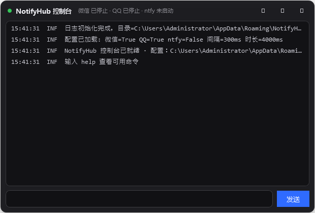

# NotifyHub v0.1

Windows 桌面「消息聚合通知 + 灵动岛 + 音乐控制」工具。
把**微信 / QQ / ntfy** 三个来源的消息统一成 macOS 风格通知横幅，同时提供一个
**WorkBuddy 任务状态灵动岛**（内含音乐播放器快捷控制）。托盘常驻、免安装、
自包含单文件 exe、弹窗不抢键盘焦点。

> 为什么要用 UI Automation 轮询？微信 / QQ 不向 Windows 系统通知中心写入消息，
> 所以只能直接读它们的会话窗口（UIA），做快照差分来发现新消息。

---

## 界面预览

| 通知横幅（深色毛玻璃四段式） | 灵动岛 / 悬浮条（横排三段） |
| --- | --- |
|  |  |

| 控制台（紧凑深色 + 彩色日志） | 设置面板 |
| --- | --- |
|  |  |

---

## 一、它能做什么

| 能力 | 说明 |
| --- | --- |
| 微信消息通知 | UIA 轮询会话列表（默认 300ms），解析「联系人 + 摘要」，做差分去重后弹通知 |
| QQ 消息通知 | 无障碍树可读时逐条推送；不可读时降级为「QQ 收到一条新消息」（5 秒冷却） |
| ntfy 订阅 | 订阅 ntfy 主题（SSE），断线自动重连并带 `since=` 续传，不丢消息 |
| 微信消息过滤 | **只推好友私聊 + 未开免打扰的群**；公众号、服务通知、广告营销、免打扰会话全部在接收阶段拦截 |
| macOS 风格通知 | 深色毛玻璃、圆角 20、四段式（图标+来源 / 会话名 / 预览 / 时间）、180ms 淡入淡出、四角可切换、新通知在最上 |
| 消息提示音 | 程序内置独立提示音，仅放行消息播放；开关 + 音量独立控制，不依赖微信/QQ 铃声 |
| 灵动岛 | 屏幕顶部居中（可切自由拖动），单行实时动作文字；展开 180ms / 文字切换 120ms / 完成停留 600ms / 收缩 220ms |
| 任务完成提示音 | 与消息提示音完全独立的第二套音效，完成态出现时播放 |
| 音乐控制 | 系统 SMTC 聚合各播放器（Folia、网易云、QQ音乐、Spotify 等），同一悬浮条内显示「♪ 歌名-歌手 + 上一首/播放暂停/下一首」 |
| 智能隐藏 | 无音频 → 音乐区隐藏；无任务 → 任务区隐藏；检测到全屏观影/游戏 → 整套灵动岛隐藏，退出后恢复 |
| 控制台 | 紧凑深色窗口：等宽日志（按级别着色）、命令输入、清空日志、折叠、设置入口 |
| 一键清除日志 | 设置页按钮 + 二次确认，只清日志，不动配置与去重记录 |
| 便携绿色包 | 解压即用，不写系统注册表；配置文件跟随程序目录，换目录运行配置不丢 |

---

## 二、界面一览

* **通知横幅**：屏幕四角（默认右上）纵向堆叠，最多 5 条，新通知在最上方；鼠标移入暂停倒计时，点击激活微信/QQ 并定位到对应聊天。
* **灵动岛 / 音乐悬浮条**：一个深色毛玻璃长条，横排三段
  `[♪] 歌名-歌手 | [上一首][播放/暂停][下一首] | 任务实时动作`。
  固定模式锁定顶部居中；自由模式按住空白处拖动，贴边吸附、位置自动保存。
* **控制台**：托盘双击或右键菜单「控制台」打开。
  可用命令：`help`、`clear`、`island <文本>`、`done <文本>`、`media <prev|toggle|next>`、
  `test <wechat|qq|ntfy|sound-message|sound-task>`、`stats`、`settings`、`pause`、`resume`。

---

## 三、命令行参数

```
NotifyHub.exe                      托盘常驻运行
NotifyHub.exe --selftest           无界面逻辑自检（退出码 0=通过）
NotifyHub.exe --selftest-ui        通知层自检（堆叠/位置/不抢焦点）
NotifyHub.exe --demo               弹 6 条演示通知并生成抓图
NotifyHub.exe --dump               导出微信/QQ 的 UIA 树（适配新版界面用）
NotifyHub.exe --locate 名字        激活微信并搜索定位到该聊天
NotifyHub.exe --island "文本"      唤起灵动岛（任务执行中）
NotifyHub.exe --island-done "文本" 灵动岛完成态 + 完成提示音
NotifyHub.exe --media toggle       控制播放器（play/pause/toggle/next/prev）
NotifyHub.exe --settings           只打开设置窗口（排版检查）
NotifyHub.exe --console            只打开控制台（排版检查）
NotifyHub.exe --help               参数帮助
```

外部程序（如 WorkBuddy 后台任务）集成方式：任务开始 `--island "正在梳理需求文档结构"`，
中途可反复调用刷新同一行文字，结束 `--island-done "任务完成"`。
常驻实例通过命名管道接收，无需重复启动进程。

---

## 四、配置（config.json）

便携模式下配置文件在 exe 同目录；否则在 `%AppData%\NotifyHub\config.json`。
保存后立即生效，坏文件会自动备份并回退默认值。

| 字段 | 默认 | 说明 |
| --- | --- | --- |
| `NtfyUrl` | `https://ntfy.sh/notifyhub-test` | 订阅地址，可只写 `ntfy.sh/主题`（自动补 https 与 /sse） |
| `NtfyEnabled` | `false` | 是否启用 ntfy |
| `WeChatEnabled` / `QQEnabled` | `true` | 监听开关 |
| `PollIntervalMs` | `300` | 轮询间隔，范围 300~2000ms |
| `NotificationDurationMs` | `4000` | 单条通知停留时长，范围 1000~30000ms |
| `NotificationCorner` | `TopRight` | `TopRight` / `TopLeft` / `BottomRight` / `BottomLeft` |
| `MaxStack` | `3` | 同屏堆叠上限（硬上限 5） |
| `IslandMode` | `Fixed` | `Fixed` 顶部居中锁定 / `Free` 自由拖动 |
| `IslandLeft` / `IslandTop` | `null` | 自由模式保存的位置（DIP） |
| `MusicEnabled` | `true` | 音乐控制模块 |
| `MessageSoundEnabled` / `MessageSoundVolume` | `true` / `80` | 消息通知提示音开关与音量 |
| `TaskSoundEnabled` / `TaskSoundVolume` | `true` / `80` | 任务完成提示音开关与音量 |
| `WeChatFilterEnabled` | `true` | 微信过滤总开关 |
| `WeChatBlockedKeywords` | 服务通知,公众号,… | 追加拦截关键词（逗号分隔，命中会话名或摘要即拦截） |
| `DedupHours` | `24` | 已推送消息 ID 缓存保留时长 |
| `AutoStart` | `false` | 开机自启（写 HKCU Run，便携模式默认关闭） |
| `DumpUiaOnStart` | `false` | 启动时导出 UIA 树（适配新版微信/QQ 用） |

---

## 五、工程结构与文件职责

```
NotifyHub/
├─ src/NotifyHub/
│  ├─ NotifyHub.csproj          项目文件：net8.0-windows10.0.19041（WinRT/SMTC）+ WPF，
│  │                            自包含单文件发布参数、版本号 v0.1
│  ├─ App.xaml / App.xaml.cs    应用入口：多模式分发（GUI/Demo/自检/Dump/Locate/Settings/
│  │                            Console/Island/Media/Help）、托盘、单实例互斥、定时落盘
│  ├─ Models/
│  │  ├─ AppConfig.cs           配置模型 + Normalize 收敛（含通知位置、两套音效、过滤关键词）
│  │  ├─ NotifyMessage.cs       一条待通知消息（来源/发送者/内容/时间/去重键）
│  │  └─ EventLogEntry.cs       事件列表条目
│  ├─ Services/
│  │  ├─ ConfigService.cs       配置读写（原子替换、坏文件备份、变更事件）
│  │  ├─ LogService.cs          日志文件 + 控制台环形缓冲 + 最近 50 条事件 + ClearAll
│  │  ├─ AppPaths.cs            路径：便携模式（exe 旁 config.json）或 %AppData%
│  │  ├─ CommandLineOptions.cs  命令行解析
│  │  ├─ MonitorController.cs   监听总控：三来源 → 去重 → 通知
│  │  ├─ PollingWatcherBase.cs  轮询线程基类（扣耗时的间隔、异常不中断、日志节流）
│  │  ├─ ChatAppWatcher.cs      聊天软件公共流程：找窗口 → 读列表 → 差分 → 过滤 → 派发
│  │  ├─ WeChatWatcher.cs       微信监听（含免打扰/公众号过滤）
│  │  ├─ QQWatcher.cs           QQ 监听（可读则逐条，不可读降级）
│  │  ├─ NtfySubscriber.cs      ntfy SSE 订阅与重连
│  │  ├─ SessionDiffTracker.cs  会话快照差分（含中断恢复补发，防丢包）
│  │  ├─ DedupCache.cs          消息 ID 去重（落盘 24h，重启不重复）
│  │  ├─ WeChatFilter.cs        微信过滤规则（免打扰信号 + 公众号/服务通知关键词）
│  │  ├─ SoundService.cs        两套提示音（合成 WAV，MediaPlayer 播放，音量独立）
│  │  ├─ MediaPlayerMonitor.cs  SMTC 媒体会话聚合与播放控制
│  │  ├─ FullscreenWatcher.cs   全屏检测（前台窗口铺满显示器且无标题栏）
│  │  ├─ StartupService.cs      开机自启注册表
│  │  ├─ WindowActivator.cs     点击通知 → 激活微信/QQ 并定位聊天
│  │  ├─ ConsoleBridge.cs       无控制台进程的 stdout 输出
│  │  ├─ SelfTest.cs            自检用例（解析/差分/去重/配置/过滤/持续化等 20 项）
│  │  ├─ Parsing/
│  │  │  ├─ MessageTextParser.cs  UIA 文本 → (联系人, 摘要)，剥离置顶/未读前缀/噪声
│  │  │  └─ NtfySseParser.cs      SSE 帧与 ntfy JSON 解析
│  │  └─ Uia/
│  │     ├─ WindowFinder.cs       EnumWindows 纯 Win32 定位主窗口（避开 UIA 根枚举卡顿）
│  │     ├─ SessionListReader.cs  读会话列表 + 免打扰/公众号信号采集
│  │     └─ UiaDumper.cs          UIA 树诊断导出
│  ├─ UI/
│  │  ├─ NotificationWindow.xaml(.cs)     单条通知卡片（深色毛玻璃四段式、180ms 动画）
│  │  ├─ NotificationManager.cs           队列 + 堆叠 + 四角定位
│  │  ├─ IslandWindow.xaml(.cs)           灵动岛/悬浮条（横排三段、拖拽、固定动效）
│  │  ├─ IslandController.cs              灵动岛总控（音乐/全屏/提示音/位置）
│  │  ├─ ConsoleWindow.xaml(.cs)          紧凑深色控制台（日志/命令/折叠）
│  │  ├─ SettingsWindow.xaml(.cs)         设置面板（含两套音效、过滤、一键清日志）
│  │  ├─ DemoCapture.cs                   窗口自渲染抓图（验证用）
│  │  └─ IconFactory.cs                   托盘图标绘制
│  ├─ Interop/NativeMethods.cs  Win32 互操作（窗口样式/激活/输入/全屏检测）
│  ├─ Services/IslandIpc.cs     命名管道：转发 --island / --media 给常驻实例
│  ├─ Assets/NotifyHub.ico      图标
│  └─ app.manifest              应用清单（DPI 感知）
├─ tools/
│  ├─ publish.ps1               一键发布单文件
│  ├─ screenshot2.ps1           区域抓屏（BitBlt + CAPTUREBLT，能抓透明窗口）
│  ├─ screenshot-full.ps1       全屏抓屏
│  ├─ fullscreen-test.ps1       全屏隐藏自动验证用临时窗体
│  └─ …                         微信窗口诊断脚本
├─ dist/                        发布产物（NotifyHub.exe）
└─ README.md                    本文档
```

运行期数据（便携模式在程序目录，否则 `%AppData%\NotifyHub`）：

```
config.json     配置
logs/           按天日志
events.json     最近 50 条事件
dedup.json      已推送消息 ID（去重，24h）
sounds/         自动生成的两个提示音 WAV
dump/           UIA 诊断树
```

---

## 六、构建 / 发布

需要 .NET 8 SDK（Windows）。仓库自带发布参数，直接：

```powershell
dotnet publish src/NotifyHub/NotifyHub.csproj -c Release -o dist
```

产物是自包含单文件 `dist\NotifyHub.exe`（约 73MB，含 .NET 运行时与 WPF/WinRT，免安装）。

自检与演示：

```powershell
.\dist\NotifyHub.exe --selftest     # 20 项逻辑自检
.\dist\NotifyHub.exe --demo         # 弹 6 条演示通知，抓图到 %AppData%\NotifyHub\demo-capture.png
```

---

## 七、已知限制

* 微信 / QQ 的界面结构随版本变化，若某天读不到会话，请用 `--dump` 导出 UIA 树后按新结构调整
  `WindowFinder` / `SessionListReader` 的类名与结构匹配。
* 公众号/服务通知的识别依赖会话名/摘要关键词与 UIA 信号；若发现漏网的公众号，
  把它的名字加进 `WeChatBlockedKeywords` 即可。免打扰识别依赖会话项里的「消息免打扰」图标信号。
* 音乐控制依赖播放器是否向 Windows 上报 SMTC（Folia、网易云、QQ音乐、Spotify 等主流播放器均支持）。
* WPF 不支持 IL 裁剪，单文件体积主要由 .NET 运行时 + WPF + WinRT 组成，已开启单文件压缩。
* 便携版不写注册表；「开机自启」是可选功能，默认关闭。

---

## 八、版本

**v0.1** — 首个公开版本（通知聚合 + 深色通知 UI + 灵动岛/音乐栏 + 控制台 + 两套提示音 + 微信过滤 + 便携包）。
