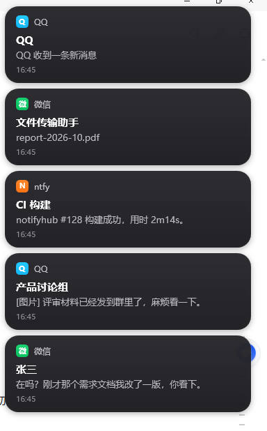
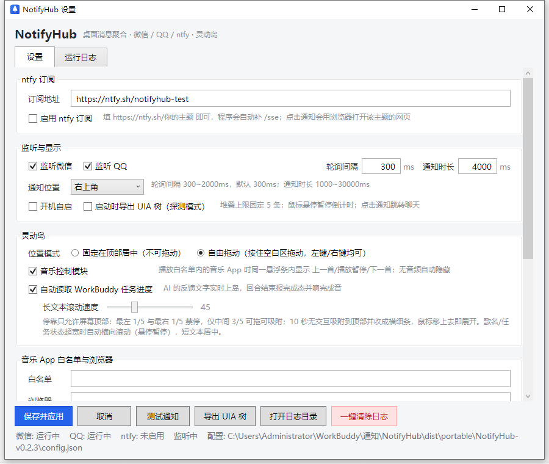
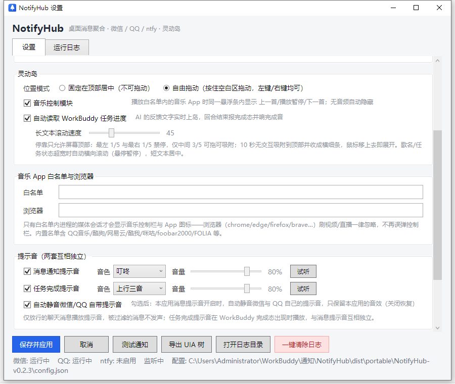
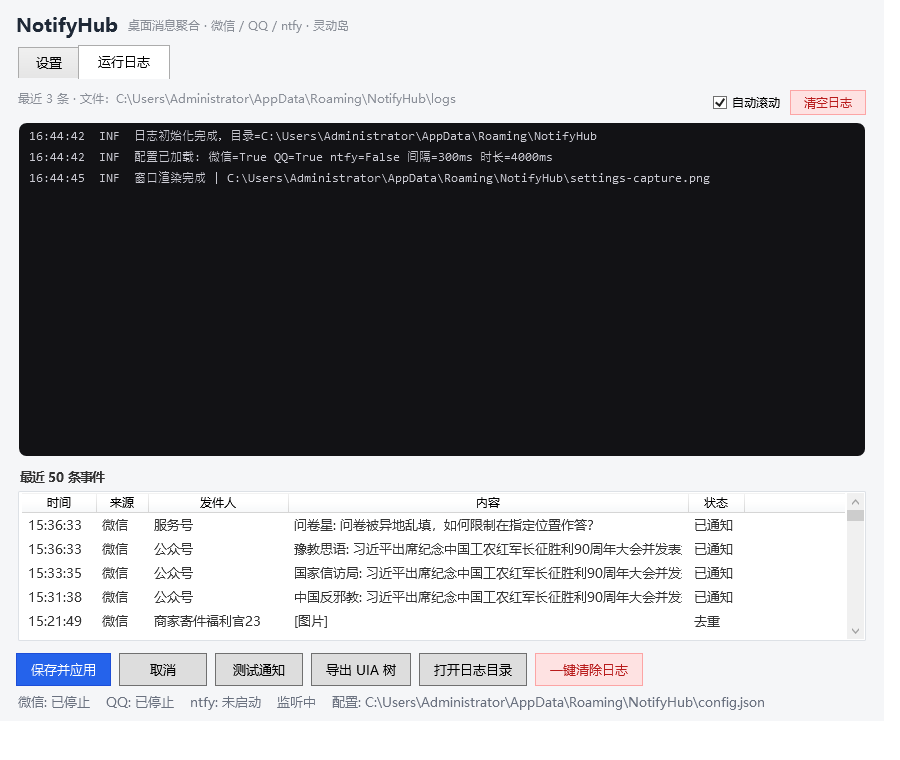

# NotifyHub

Windows 桌面「消息聚合通知 + 灵动岛 + 音乐控制」工具。
把**微信 / QQ / ntfy** 三个来源的消息统一成 macOS 风格通知横幅，同时提供一个
**WorkBuddy 任务状态灵动岛**（内含音乐播放器快捷控制）。托盘常驻、免安装、
自包含单文件 exe、弹窗不抢键盘焦点。

**下载**：[Release v0.2.3](https://github.com/lingli00/NotifyHub/releases/tag/v0.2.3)
→ `NotifyHub-v0.2.3-portable-win-x64.zip`（解压即用）或 `NotifyHub-v0.2.3-source.zip`（完整工程）。

> 为什么要用 UI Automation 轮询？微信 / QQ 不向 Windows 系统通知中心写入消息，
> 所以只能直接读它们的会话窗口（UIA），做快照差分来发现新消息。

---

## 界面预览

| 通知横幅（深色毛玻璃四段式） | 灵动岛 / 悬浮条（横排 + 单行状态） |
| --- | --- |
|  |  |

| 设置面板 | 音乐 App 白名单与浏览器 |
| --- | --- |
|  |  |

| 运行日志（原独立控制台已并入） | AI 任务进度实时上岛 |
| --- | --- |
|  |  |

10 秒无交互后吸附收成细条（贴左右边为竖条），鼠标移上去即展开：


---

## 一、它能做什么

| 能力 | 说明 |
| --- | --- |
| 微信消息通知 | UIA 轮询会话列表（默认 300ms），解析「联系人 + 摘要」，做差分去重后弹通知 |
| QQ 消息通知 | 无障碍树可读时逐条推送；不可读时降级为「QQ 收到一条新消息」（5 秒冷却） |
| ntfy 订阅 | 订阅 ntfy 主题（SSE），断线自动重连并带 `since=` 续传，不丢消息；**点击通知直接打开该 topic 的 Web UI**（浏览器可配） |
| 微信消息过滤 | **只推好友私聊 + 未开免打扰的群**；公众号、服务号、服务通知、广告营销、免打扰会话全部在接收阶段拦截 |
| macOS 风格通知 | 深色毛玻璃、圆角 20、四段式（图标+来源 / 会话名 / 预览 / 时间）、180ms 淡入淡出、四角可切换、新通知在最上 |
| 消息提示音 | 程序内置独立提示音（5 种音色可试听），仅放行消息播放；开关 + 音量独立控制；**开启时自动静音微信/QQ 自带提示音** |
| 灵动岛 | 一行实时动作文字；展开 180ms / 文字切换 120ms / 完成停留 600ms / 收缩 220ms |
| 长文本跑马灯 | 歌名 / ntfy 正文 / 任务状态超宽时**自动横向无缝滚动**（悬停暂停、移开恢复），速度可调（10~120）；短文本水平居中，长文本滚动时可视区中心钉在岛中心 |
| 拖拽 | 自由模式下按住条体空白处拖动，**左键、右键都能拖**，按钮区域自动让位给点击 |
| 停靠规则 | 只允许停靠**屏幕顶部**：最左 1/5 与最右 1/5 禁停，仅中间 3/5 可拖可吸附；10 秒无交互吸附到顶部并收成横细条，鼠标移上去即展开 |
| 状态通道 | 命名管道长连接 + `--island-stream`：**连续更新延迟 <100ms**（实测每行 0.12ms） |
| WorkBuddy 任务监控 | **自动**读取 WorkBuddy 本地会话记录：AI 每一步动作实时上岛（运行/修改/检索/派出助手…），回合结束绿勾 + 完成提示音，无需任何手动接线 |
| 任务完成提示音 | 与消息提示音完全独立的第二套音效，完成态出现时播放 |
| 音乐控制 | 系统 SMTC 聚合各播放器（Folia、网易云、QQ音乐、Spotify 等），同一悬浮条内显示「App 图标 + 歌名-歌手 + 上一首/播放暂停/下一首」；**只有白名单内进程才显示**（浏览器刷视频/直播一律忽略），无音频自动隐藏 |
| 消息游标 | 各来源已读进度落盘（`cursor.json`），重启不补弹旧消息；首运行只建基线 |
| 智能隐藏 | 无音频 → 音乐区隐藏；无任务 → 任务区隐藏；检测到全屏观影/游戏 → 整套灵动岛隐藏，退出后恢复 |
| 运行日志 | 设置页「运行日志」标签页：大号深色日志框（按级别着色、自动滚到底、可暂停）、最近 50 条事件。**独立控制台窗口已取消** |
| 一键清除日志 | 设置页按钮 + 二次确认，只清日志，不动配置与去重记录 |
| 便携绿色包 | 解压即用，不写系统注册表；配置文件跟随程序目录，换目录运行配置不丢 |

---

## 二、界面一览

* **通知横幅**：屏幕四角（默认右上）纵向堆叠，最多 5 条，新通知在最上方；鼠标移入暂停倒计时，点击激活微信/QQ 并定位到对应聊天。
* **灵动岛 / 音乐悬浮条**：一个深色毛玻璃长条，横排
  `[App 图标] 歌名-歌手 | [上一首][播放/暂停][下一首] | 一行任务动作`。

  * 固定模式锁定顶部居中（不可拖动）。
  * 自由模式按住空白处拖动（左键、右键均可），位置自动保存；10 秒无交互自动吸附到**屏幕顶部**并收成横细条。
  * 停靠分区：最左 1/5 与最右 1/5 禁停，仅中间 3/5 可拖可吸附（以岛中心点判定）。
  * 歌名 / ntfy 正文 / 任务状态超宽时自动横向滚动（悬停暂停），短文本居中；滚动速度可调。
  * 条体现已按内容自适应，阴影留白足够，不再出现"比内容大一圈的灰白模糊方框"。
  * 阴影留白区做鼠标穿透（`WM_NCHITTEST` → `HTTRANSPARENT`），不会挡住下层窗口的点击。
* **设置 + 运行日志**：托盘双击或右键「设置 / 日志…」打开，两个标签页：
  * **设置**：订阅、监听与显示、灵动岛（位置模式 / 音乐开关 / 滚动速度）、音乐 App 白名单与浏览器、两套提示音、微信过滤。
  * **运行日志**：等宽字体详细日志（DBG/INF/SUC/WRN/ERR 着色）+ 最近 50 条事件。

---

## 三、命令行参数

```
NotifyHub.exe                      托盘常驻运行
NotifyHub.exe --selftest           无界面逻辑自检（退出码 0=通过，20 项）
NotifyHub.exe --selftest-ui        通知层自检（堆叠/位置/不抢焦点）
NotifyHub.exe --demo               弹 6 条演示通知并生成抓图
NotifyHub.exe --dump               导出微信/QQ 的 UIA 树（适配新版界面用）
NotifyHub.exe --locate 名字        激活微信并搜索定位到该聊天
NotifyHub.exe --island "文本"      灵动岛：显示一行执行中动作
NotifyHub.exe --island-done "文本" 灵动岛：完成态 + 完成提示音后收起
NotifyHub.exe --island-stream      从标准输入逐行读状态（长连接，更新延迟 <100ms）
NotifyHub.exe --media toggle       控制播放器（play/pause/toggle/next/prev）
NotifyHub.exe --settings           只打开设置窗口（排版检查）
NotifyHub.exe --help               参数帮助
```

### 外部程序（如 WorkBuddy 后台任务）怎么集成

**方式一：单次命令（简单，但每次要付进程启动成本）**

```
NotifyHub.exe --island "正在梳理需求文档结构"
NotifyHub.exe --island "已解析 8 个章节，开始拆分任务"
NotifyHub.exe --island-done "任务完成"
```

单次命令的端到端延迟约 **270ms**，其中绝大部分是 exe 启动本身（约 250ms），
状态通道只占 1~2ms。

**方式二：常驻状态流（推荐，满足「更新延迟 <100ms」）**

进程只启动一次，之后每行状态走同一条管道长连接：

```powershell
# 交互式
$p = Start-Process -FilePath .\NotifyHub.exe -ArgumentList '--island-stream' -RedirectStandardInput stdin.txt

# 或直接管道（每一行就是一次状态更新）
@(
  'RUN|正在读取需求文档…'
  'RUN|任务 3/6：四边吸附与自动滑出'
  'DONE|两份包已就绪'
) | .\NotifyHub.exe --island-stream
```

协议（一行一条）：

| 行格式 | 含义 |
| --- | --- |
| `RUN|文本` | 执行中，黄点 + 文本；直接写纯文本等价于 `RUN|纯文本` |
| `DONE|文本` | 完成态，绿勾 + 文本，600ms 后收起并响完成提示音 |
| `MEDIA|toggle` | 媒体控制（toggle/play/pause/next/prev） |

实测：常驻流模式下每行状态写入 **0.12ms**，端到端（含 UI 上屏）远低于 100ms。

---

## 四、配置（config.json）

便携模式下配置文件在 exe 同目录；否则在 `%AppData%\NotifyHub\config.json`。
保存后立即生效，坏文件会自动备份并回退默认值。

| 字段 | 默认 | 说明 |
| --- | --- | --- |
| `NtfyUrl` | `https://ntfy.sh/notifyhub-test` | 订阅地址，可只写 `ntfy.sh/主题`（自动补 https 与 /sse） |
| `NtfyEnabled` | `false` | 是否启用 ntfy |
| `WeChatEnabled` / `QQEnabled` | `true` | 监听开关 |
| `PollIntervalMs` | `300` | 轮询间隔，范围 300~2000ms |
| `NotificationDurationMs` | `4000` | 单条通知停留时长，范围 1000~30000ms |
| `NotificationCorner` | `TopRight` | `TopRight` / `TopLeft` / `BottomRight` / `BottomLeft` |
| `MaxStack` | `3` | 同屏堆叠上限（硬上限 5） |
| `IslandMode` | `Fixed` | `Fixed` 顶部居中锁定 / `Free` 自由拖动（含四边吸附） |
| `IslandLeft` / `IslandTop` | `null` | 自由模式保存的**拖拽落点**（DIP）；吸附位置不写盘，重启后从落点开始重新计时 |
| `MusicEnabled` | `true` | 音乐控制模块（勾选→显示、取消→隐藏，保存后立即生效） |
| `MarqueeSpeed` | `45` | 长文本跑马灯滚动速度（DIP/秒，范围 10~120） |
| `MusicAppWhitelist` | `""` | 音乐 App 进程名白名单（逗号分隔）；留空 = 内置默认名单（浏览器一律忽略） |
| `BrowserPath` | `""` | 点击 ntfy 通知时唤起的浏览器；留空 = 系统默认 |
| `MessageSoundEnabled` / `MessageSoundVolume` | `true` / `80` | 消息通知提示音开关与音量 |
| `MessageSoundStyle` | `DingDong` | 消息音色：DingDong/Crystal/Bubble/Marimba/Digital |
| `TaskSoundStyle` | `Ascend` | 完成音色：Ascend/Success/Bell/Chord |
| `SuppressAppSounds` | `true` | 消息提示音开启时自动静音微信/QQ 自带提示音 |
| `TaskSoundEnabled` / `TaskSoundVolume` | `true` / `80` | 任务完成提示音开关与音量 |
| `WeChatFilterEnabled` | `true` | 微信过滤总开关 |
| `WeChatBlockedKeywords` | 服务通知,公众号,… | 追加拦截关键词（逗号分隔，命中会话名或摘要即拦截） |
| `DedupHours` | `24` | 已推送消息 ID 缓存保留时长 |
| `AutoStart` | `false` | 开机自启（写 HKCU Run，便携模式默认关闭） |
| `DumpUiaOnStart` | `false` | 启动时导出 UIA 树（适配新版微信/QQ 用） |

---

## 五、工程结构与文件职责

```
NotifyHub/
├─ src/NotifyHub/
│  ├─ NotifyHub.csproj          项目文件：net8.0-windows10.0.19041（WinRT/SMTC）+ WPF，
│  │                            自包含单文件发布参数、版本号 v0.2
│  ├─ App.xaml / App.xaml.cs    应用入口：多模式分发（GUI/Demo/自检/Dump/Locate/Settings/
│  │                            Island/IslandStream/Media/Help）、灵动岛快路径、托盘、单实例互斥
│  ├─ Models/
│  │  ├─ AppConfig.cs           配置模型 + Normalize 收敛（含通知位置、两套音效、过滤关键词）
│  │  ├─ NotifyMessage.cs       一条待通知消息（来源/发送者/内容/时间/去重键）
│  │  └─ EventLogEntry.cs       事件列表条目
│  ├─ Services/
│  │  ├─ ConfigService.cs       配置读写（原子替换、坏文件备份、变更事件）
│  │  ├─ LogService.cs          日志文件 + 控制台环形缓冲 + 最近 50 条事件 + ClearAll
│  │  ├─ AppPaths.cs            路径：便携模式（exe 旁 config.json）或 %AppData%
│  │  ├─ CommandLineOptions.cs  命令行解析
│  │  ├─ IslandIpc.cs           命名管道：长连接 + 多行读取 + --island-stream 流式转发
│  │  ├─ MonitorController.cs   监听总控：三来源 → 去重 → 通知
│  │  ├─ PollingWatcherBase.cs  轮询线程基类（扣耗时的间隔、异常不中断、日志节流）
│  │  ├─ ChatAppWatcher.cs      聊天软件公共流程：找窗口 → 读列表 → 差分 → 过滤 → 派发
│  │  ├─ WeChatWatcher.cs       微信监听（含免打扰/公众号/服务号过滤）
│  │  ├─ QQWatcher.cs           QQ 监听（可读则逐条，不可读降级）
│  │  ├─ NtfySubscriber.cs      ntfy SSE 订阅与重连
│  │  ├─ SessionDiffTracker.cs  会话快照差分（含中断恢复补发，防丢包）
│  │  ├─ MessageCursorStore.cs  消息游标持久化（重启不补弹旧消息，首运行只建基线）
│  │  ├─ DedupCache.cs          消息 ID 去重（落盘 24h，重启不重复）
│  │  ├─ WeChatFilter.cs        微信过滤规则（免打扰信号 + 公众号/服务通知关键词）
│  │  ├─ SoundService.cs        两套提示音（多音色合成 WAV，MediaPlayer 播放，音量独立，可试听）
│  │  ├─ AppSoundMuter.cs       Core Audio 会话级静音：消息音开启时静音微信/QQ 自带提示音
│  │  ├─ MediaPlayerMonitor.cs  SMTC 媒体会话聚合与播放控制（按白名单过滤）
│  │  ├─ MusicAppWhitelist.cs   音乐 App 白名单（内置名单 + 用户追加，浏览器一律忽略）
│  │  ├─ AppIconExtractor.cs    从进程提取 App 图标（音乐栏左侧透明圆角图标）
│  │  ├─ BrowserLauncher.cs     ntfy 点击 → 浏览器打开 topic Web UI
│  │  ├─ FullscreenWatcher.cs   全屏检测（前台窗口铺满显示器且无标题栏）
│  │  ├─ StartupService.cs      开机自启注册表
│  │  ├─ WindowActivator.cs     点击通知 → 激活微信/QQ 并定位聊天
│  │  ├─ ConsoleBridge.cs       无控制台进程的 stdout 输出
│  │  ├─ SelfTest.cs            自检用例（解析/差分/去重/配置/过滤/持续化等 20 项）
│  │  ├─ Parsing/
│  │  │  ├─ MessageTextParser.cs  UIA 文本 → (联系人, 摘要)，剥离置顶/未读前缀/噪声
│  │  │  └─ NtfySseParser.cs      SSE 帧与 ntfy JSON 解析
│  │  └─ Uia/
│  │     ├─ WindowFinder.cs       EnumWindows 纯 Win32 定位主窗口（避开 UIA 根枚举卡顿）
│  │     ├─ SessionListReader.cs  读会话列表 + 免打扰/公众号信号采集
│  │     └─ UiaDumper.cs          UIA 树诊断导出
│  ├─ UI/
│  │  ├─ NotificationWindow.xaml(.cs)     单条通知卡片（圆角 20、阴影留白 14px、180ms 动画）
│  │  ├─ NotificationManager.cs           队列 + 堆叠 + 四角定位
│  │  ├─ MarqueeText.cs                   长文本跑马灯控件（无缝循环、悬停暂停、速度可调）
│  │  ├─ IslandWindow.xaml(.cs)           灵动岛：单行状态、Win32 拖拽、顶部停靠分区、细条形态、定参动效
│  │  ├─ SnapStripWindow.cs               吸附细条（贴顶横条，移入展开）
│  │  ├─ IslandController.cs              灵动岛总控（音乐/全屏/提示音/位置/窗口预热）
│  │  ├─ SettingsWindow.xaml(.cs)         「设置 + 运行日志」双标签页（原控制台已并入）
│  │  ├─ DemoCapture.cs                   窗口自渲染抓图（验证用）
│  │  └─ IconFactory.cs                   托盘图标绘制
│  ├─ Interop/NativeMethods.cs  Win32 互操作（窗口样式/SetCapture/SetWindowPos/激活/输入）
│  ├─ Assets/NotifyHub.ico      图标
│  └─ app.manifest              应用清单（DPI 感知）
├─ tools/
│  ├─ publish.ps1               一键发布单文件
│  ├─ pack.py                   打发布包（便携包 + 源码包）
│  ├─ grab.py                   区域抓屏（BitBlt + CAPTUREBLT，能抓透明窗口）
│  ├─ island_probe.py           灵动岛真机探测：读位置 / 真实鼠标拖拽（左键、右键）
│  ├─ stream_latency.py         量 --island-stream 每行更新耗时
│  ├─ push_api.py               走 GitHub Git Data API 推送提交（git 协议被墙时用）
│  ├─ release_api.py            走 API 创建 Release 并上传两个 zip
│  └─ …                         微信窗口诊断脚本
├─ docs/                        文档截图
├─ dist/                        发布产物（NotifyHub.exe）
└─ README.md                    本文档
```

运行期数据（便携模式在程序目录，否则 `%AppData%\NotifyHub`）：

```
config.json     配置
logs/           按天日志
events.json     最近 50 条事件
dedup.json      已推送消息 ID（去重，24h）
sounds/         自动生成的两个提示音 WAV
dump/           UIA 诊断树
```

---

## 六、构建 / 发布

需要 .NET 8 SDK（Windows）。仓库自带发布参数，直接：

```powershell
dotnet publish src/NotifyHub/NotifyHub.csproj -c Release -o dist
```

产物是自包含单文件 `dist\NotifyHub.exe`（约 73MB，含 .NET 运行时与 WPF/WinRT，免安装）。

自检与验证：

```powershell
.\dist\NotifyHub.exe --selftest        # 20 项逻辑自检
.\dist\NotifyHub.exe --selftest-ui     # 通知层自检（0=通过）
.\dist\NotifyHub.exe --demo            # 弹 6 条演示通知并抓图
python tools\island_probe.py info      # 读灵动岛位置/样式
python tools\island_probe.py drag 160 130   # 真实鼠标拖拽验证
python tools\stream_latency.py         # 状态流延迟
```

---

## 七、已知限制

* 微信 / QQ 的界面结构随版本变化，若某天读不到会话，请用 `--dump` 导出 UIA 树后按新结构调整
  `WindowFinder` / `SessionListReader` 的类名与结构匹配。
* 公众号/服务通知的识别依赖会话名/摘要关键词与 UIA 信号；若发现漏网的公众号，
  把它的名字加进 `WeChatBlockedKeywords` 即可。免打扰识别依赖会话项里的「消息免打扰」图标信号。
* 音乐控制依赖播放器是否向 Windows 上报 SMTC（Folia、网易云、QQ音乐、Spotify 等主流播放器均支持）。
* WPF 不支持 IL 裁剪，单文件体积主要由 .NET 运行时 + WPF + WinRT 组成，已开启单文件压缩。
* 便携版不写注册表；「开机自启」是可选功能，默认关闭。
* 单次 `--island` 命令仍有约 270ms 启动开销（.NET 运行时 + WPF 初始化），
  这是"一次进程启动"的固有成本；需要 <100ms 时应改用 `--island-stream` 长连接。
* 吸附位置不写盘：自由模式的吸附是**临时视觉状态**，配置里只保存用户亲手拖到的落点，
  这样重启后不会"一开机就贴在边上"。

---

## 八、版本

**v0.2.3** — 长文本跑马灯 / 停靠收紧 / 音乐图标与白名单 / 旧消息不补弹

* **长文本跑马灯**（新控件 `MarqueeText`）：歌名、ntfy 正文、任务状态超宽自动横向无缝滚动，悬停暂停、移开恢复；速度可调（`MarqueeSpeed`，默认 45）
* **文本居中锚定**：短文本水平居中；长文本滚动时可视区中心钉在岛中心
* **音乐 App 图标**：播放白名单内音乐时岛最左显示该 App 透明圆角图标（新模块 `AppIconExtractor`），无音频自动收起
* **音乐 App 白名单**（`MusicAppWhitelist`）：只有白名单内进程的媒体会话才显示音乐控制栏；**浏览器（chrome/edge/firefox/brave…）刷视频/直播一律忽略**，修复误触发
* **ntfy 点击唤起浏览器**：点击通知打开该 topic 的 Web UI，`BrowserPath` 可配（新模块 `BrowserLauncher`）
* **消息游标持久化**（新模块 `MessageCursorStore`）：重启不再补弹旧消息，首运行只建基线
* **停靠规则收紧**：只允许停靠屏幕顶部；最左 1/5 与最右 1/5 禁停，仅中间 3/5 可停；固定模式钉顶中
* **微信服务号屏蔽**：公众号 / 服务号消息在接收阶段直接拦截
* **修复音乐开关失灵**：勾选→显示、取消→隐藏，连续切换 3 次均正常（真机验收通过）

**v0.2.2** — 上岛内容/吸附细条/动画帧率/音效增强

* 灵动岛优先显示 **AI 的反馈文字**（不再显示"运行 xxx"命令；命令摘要仅兜底）
* 吸附收成**细条**：贴左右边为竖条、贴上下边为横条，移入/点击展开，离开 1.4s 收回
* 移除 `DropShadowEffect` + 淡入淡出改走窗口级 Opacity，**弹出动画不再掉帧**
* 提示音音色可选（消息 5 种 / 完成 4 种，可试听），合成增益加大更响
* 新增**自动静音微信/QQ 自带提示音**（Core Audio 会话级，关闭恢复）
* 修复设置页灵动岛分组文字重叠

**v0.2.1** — 修复「正式版读不到 WorkBuddy 任务进度」

* 新模块 `WorkBuddyWatcher`：增量 tail WorkBuddy 本地会话记录（`~\.workbuddy\projects\**\*.jsonl`），
  AI 每一步工具调用实时上岛；回合结束（回复后安静 8 秒）报绿勾完成态 + 完成提示音；3 分钟无事件自动收起。
* 此前任务状态只有外部命令一条被动通道——在 WorkBuddy 里正常跑任务时没人调用它，岛上永远只有音乐。
* 设置页新增开关「自动读取 WorkBuddy 任务进度」（默认开启）；外部命令推送后 15 秒内优先。

**v0.2** — 灵动岛重构 + 拖拽/吸附 + 日志合并

* 灵动岛动效重做：弹出/收起改为「淡入 + 落位」单段动画，加动画令牌防止新旧动画互相拉扯（去粘连）
* 灵动岛只保留**一行**状态文字，完成态显示绿勾 + 完成文案
* **修复自由模式拖不动**：拖拽链路下沉到 Win32 消息（`WM_MOUSEACTIVATE` 回 `MA_NOACTIVATE`、
  `WM_LBUTTONDOWN/RBUTTONDOWN` + `SetCapture` + `SetWindowPos`），左键/右键均可拖，按钮区域自动让位
* 新增**四边吸附**：10 秒无交互滑到最近边（留 8px 缝），鼠标移入滑出 48px，移开重新计时（240ms ease-out）
* 新增 `--island-stream`：命名管道长连接 + 多行读取，连续状态更新延迟 <100ms（实测 0.12ms/行）
* 灵动岛快路径：`--island/--island-done/--media` 抢在日志/配置/声音初始化之前处理，单次命令 400ms → 270ms
* 取消独立控制台窗口，日志并入设置页「运行日志」标签页（深色日志框 + 级别着色 + 自动滚动 + 事件列表）
* 修复所有悬浮组件「阴影被窗口矩形裁成灰白硬边方框」：阴影收紧到 blur 12 / depth 2，留白加到 14px
* 阴影留白区鼠标穿透（`WM_NCHITTEST` → `HTTRANSPARENT`），不再挡住下层窗口
* 修复设置页「拦截关键词」与说明文字重叠
* 设置页按钮行固定在底部，不再随内容滚出视野

**v0.1** — 首个公开版本（通知聚合 + 深色通知 UI + 灵动岛/音乐栏 + 控制台 + 两套提示音 + 微信过滤 + 便携包）。
